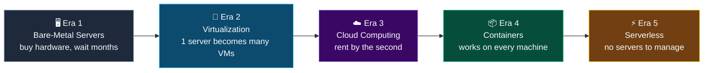

# 00 · History and Cloud Evolution: Why AWS Exists

> **Goal of this module:** before touching a single AWS service, understand the 5 problems that forced the world to invent the cloud. Once you know the *pain*, every AWS service will feel obvious.

🎬 **Interactive app:** [open the Cloud Evolution Timeline](https://jyotipr45.github.io/aws-visual-architecture-mastery/visual-app/) (React app, click anything for full details) · [legacy HTML version](https://jyotipr45.github.io/aws-visual-architecture-mastery/visual-animations/00-cloud-evolution-timeline.html)

---

## The 5 revolutions at a glance

## Lessons in this module

| # | Lesson | The pain it solved | AWS service born from it |
|---|---|---|---|
| 0.1 | [On-premises bare-metal servers](./lesson-0.1-bare-metal-servers.md) ✅ | Months of waiting, paying for idle machines | *(the problem itself)* |
| 0.2 | [Virtualization and hypervisors](./lesson-0.2-virtualization-and-hypervisors.md) ✅ | One app per server wasted 80%+ of the hardware | **EC2** (Elastic Compute Cloud) |
| 0.3 | Cloud computing and elastic scaling | Buying for peak traffic, idle the rest of the year | **Auto Scaling, S3** |
| 0.4 | Microservices and containers | "It works on my machine" | **ECS, EKS, ECR** |
| 0.5 | Serverless and event-driven | Still paying for servers that sit idle at 3 AM | **Lambda, API Gateway, DynamoDB** |

## FoodDash through the eras

Imagine launching FoodDash in each era:

| Era | How you would launch FoodDash | Time to launch |
|---|---|---|
| 1. Bare-metal | Buy servers, rent a room, hire someone for cooling and power | 3 to 6 months |
| 2. Virtualization | Still buy servers, but run many apps on each one | 1 to 3 months |
| 3. Cloud | Run one command, get a server in a minute | Minutes |
| 4. Containers | Package the app once, run the exact same package everywhere | Minutes, and reliable |
| 5. Serverless | Upload just your function code; AWS runs it only when an order comes in | Seconds, pay per millisecond |

---

✅ Module status: **Lessons 0.1 and 0.2 live**, more lessons arrive one at a time.
