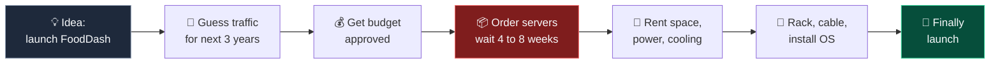
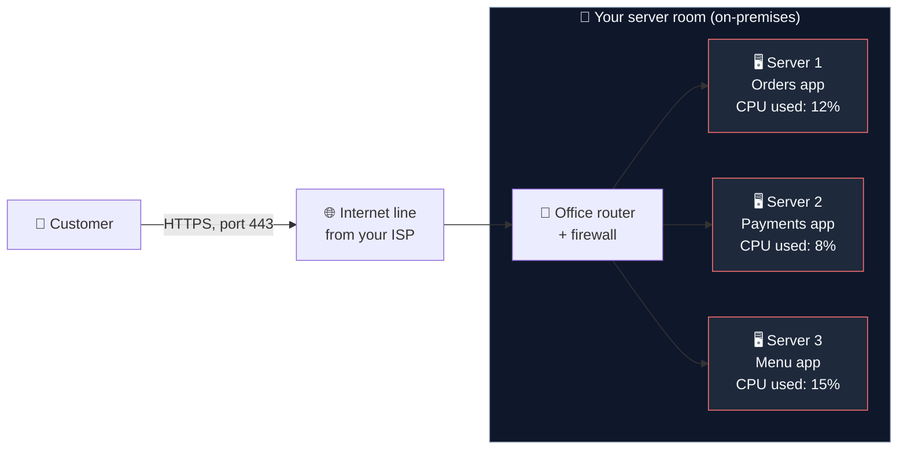

# Lesson 0.1 · Life Before the Cloud: Bare-Metal Servers

> ⏱️ 15 min read · 🧪 10 min lab · 💰 **$0.00** (this lab creates nothing in AWS)
>
> 🎬 **Watch first:** [Cloud Evolution Timeline, Era 1](https://jyotipr45.github.io/aws-visual-architecture-mastery/visual-app/) (click any box or arrow in it to inspect it)
>
> 📖 **Interactive version of this lesson:** [open Lesson 0.1 in the app](https://jyotipr45.github.io/aws-visual-architecture-mastery/visual-app/#lesson-0.1) (capacity calculator, copy buttons, reveal-the-answer cards)

**The one idea of this lesson:** before AWS, running an app meant *buying and babysitting physical computers*. Every AWS service you will learn later exists to remove one of the pains you'll see here.

---

## 1. The story: launching FoodDash in 2003

Imagine it's 2003 and you want to launch FoodDash. There's no AWS yet. Here's what you have to do:



**Three to six months** pass before a single customer can order a samosa. And you decided how many servers to buy on day one, before you knew how popular FoodDash would be.

Then you follow the golden rule of that era: **one app per server**. Orders, Payments and Menu each get their own machine, so a crash in one can't take down the others.



Look at those CPU numbers. You paid for 100% of three machines and you're using about 12% of each. **The rest is paid for, powered, cooled... and idle.**

---

## 2. Every word, explained

| Word | Nickname / alias | What it means in plain English | Why it matters for FoodDash |
|---|---|---|---|
| **Server** | box, machine, host | A computer whose job is to answer requests from other computers (a "client" asks, the "server" serves). | It's where the FoodDash order code runs. |
| **Bare-metal** | physical server, dedicated server | Your software runs *directly* on the real hardware, with no layer in between. "Metal" = the physical machine. | Simple, but one machine can only safely run one app. |
| **On-premises** | on-prem | The servers sit in a building *you* own or rent, not in someone else's data center. | You are responsible for everything: the room, power, cooling, security. |
| **Data center** | DC, server room | A building (or room) designed to hold many servers, with strong power, cooling and network connections. | AWS today owns huge ones; in 2003 you built your own small one. |
| **Rack** | server rack, cabinet | A tall metal frame that holds servers stacked like drawers. Server height is measured in **U** (1U = 1.75 inches). | A "2U server" takes two slots in the rack. |
| **CPU** | Central Processing Unit, processor | The computer's brain: it runs your code's instructions. | More CPU = more orders handled per second. |
| **RAM** | Random Access Memory, memory | Super-fast short-term memory. Cleared when the power goes off. | Your running Java app and its data live here. |
| **Disk** | storage, HDD / SSD | Slow but permanent memory. Survives power-off. | The operating system, app files and database live here. |
| **OS** | Operating System | The base software that controls the hardware, like Linux or Windows. | Your Spring Boot app runs on top of it. |
| **Utilization** | CPU %, usage | How much of a resource is actually busy. | Low utilization = money wasted on idle hardware. |
| **Provisioning** | spinning up, setting up | Getting a new server ready to use. | On-prem: months. In AWS: about a minute. |
| **Lead time** | provisioning time | Time from "we need a server" to "it's serving customers". | Long lead time means you must guess traffic in advance. |
| **Capacity planning** | sizing | Guessing how much hardware you'll need in the future. | Guess too low: crash. Guess too high: waste. |
| **CapEx** | Capital Expenditure, upfront cost | Money spent upfront to *buy* something you own. | Buying servers is CapEx: you pay before earning anything. |
| **OpEx** | Operating Expenditure, running cost | Money paid regularly for what you *use*, like rent or electricity. | The cloud turns servers into OpEx: pay per second. |
| **Depreciation** | write-down | Hardware loses value every year and needs replacing every 3 to 5 years. | You'll buy all those servers again in a few years. |
| **SPOF** | Single Point Of Failure | One part whose failure breaks the whole system. | If Server 2 dies, nobody can pay. |

---

## 3. The three big pains

### 😫 Pain 1: It's slow
Need a 4th server because FoodDash is growing? Order it, wait weeks for delivery, rack it, cable it, install the OS. Your competitor, meanwhile, has already launched.

### 💸 Pain 2: It's expensive, even when idle
You pay for the hardware upfront (CapEx), then pay for electricity, cooling and space **24 hours a day**, even at 3 AM when nobody is ordering food.

### 🎲 Pain 3: Capacity planning is a guessing game

Say one server handles **100 orders per minute**:

| Day | Orders per minute | Servers needed |
|---|---|---|
| Normal weekday | 100 | 1 |
| Diwali sale | 1,000 | 10 |

You have two bad choices:

| Your choice | What happens on Diwali | What happens the other 360 days |
|---|---|---|
| **Buy 1 server** (plan for normal days) | 💥 Site crashes, orders lost, angry customers on social media | 👍 Fine |
| **Buy 10 servers** (plan for the peak) | 👍 Fine | 💸 9 servers sit idle; average utilization is about 10% |

There's no right answer, because the hardware can't grow and shrink. **Hold on to this table**: in Lesson 0.3 you'll see how AWS Auto Scaling makes this problem disappear.

---

## 4. 🧪 Hands-on lab: treat your laptop like a bare-metal server

**Goal:** see the same CPU, RAM, disk and utilization numbers a 2003 sysadmin (system administrator) would have watched, on the computer in front of you.
**Cost:** $0.00. Nothing is created in AWS.
**Where:** Windows PowerShell (no admin rights needed).

### Step 1: Inspect your "server's" hardware

```powershell
# CPU: the brain. Cores = physical brains, logical processors = threads it can run at once
Get-CimInstance Win32_Processor | Select-Object Name, NumberOfCores, NumberOfLogicalProcessors

# RAM: short-term memory, shown in GB
Get-CimInstance Win32_ComputerSystem | Select-Object @{n='RAM_GB'; e={[math]::Round($_.TotalPhysicalMemory / 1GB, 1)}}

# Disk: long-term storage on drive C:
Get-PSDrive C | Select-Object @{n='Used_GB'; e={[math]::Round($_.Used / 1GB)}}, @{n='Free_GB'; e={[math]::Round($_.Free / 1GB)}}
```

**What you just did:** asked Windows (the OS) to describe the bare-metal hardware it runs on. In the cloud, you'll pick these same three numbers from a menu instead of buying them.

### Step 2: Measure utilization, the number that started the cloud revolution

```powershell
# Sample total CPU usage once per second, 5 times
Get-Counter '\Processor(_Total)\% Processor Time' -SampleInterval 1 -MaxSamples 5
```

You'll most likely see single-digit or low double-digit numbers. **That's the point:** most computers sit mostly idle most of the time. Multiply that by thousands of company servers worldwide, and you can see why someone eventually asked, *"Why not share all this idle hardware?"*

> 💡 If your Windows isn't in English, that counter name may differ. Instead, open **Task Manager → Performance → CPU** and watch the "Utilization" number.

### Step 3: Do the FoodDash capacity-planning math

```powershell
$ordersNormal    = 100    # orders per minute on a normal day
$ordersPeak      = 1000   # orders per minute during the Diwali sale
$ordersPerServer = 100    # what one server can handle

$serversToBuy = [math]::Ceiling($ordersPeak / $ordersPerServer)
$avgUtil      = [math]::Round(($ordersNormal / ($serversToBuy * $ordersPerServer)) * 100)

"Servers to buy for the peak : $serversToBuy"
"Average utilization         : $avgUtil %"
"Hardware idle on normal days: $(100 - $avgUtil) %"
```

Expected output:
```text
Servers to buy for the peak : 10
Average utilization         : 10 %
Hardware idle on normal days: 90 %
```

**Try it:** change `$ordersPeak` to `5000` (a viral cricket-final promotion) and run it again. Then picture yourself asking your boss to approve buying 50 servers that will be about 98% idle most of the year.

---

## 5. 🤔 What happens if...?

Think about your answer first, then click to reveal it.

<details>
<summary><b>1. ...the Diwali sale brings 10x traffic, but you only bought servers for normal days?</b></summary>

The single Orders server hits 100% CPU, requests queue up, and then time out. Customers see errors and order from a competitor. You **can't** fix it that day, because buying a new server takes weeks (lead time). That's the core pain the cloud's elastic scaling solves (Lesson 0.3).
</details>

<details>
<summary><b>2. ...Server 2's power supply dies at 2 AM?</b></summary>

Payments goes down completely, because Server 2 was a **single point of failure (SPOF)**. Someone has to drive to the server room with a spare part. Until then, nobody can pay. In AWS you'll learn to run copies across separate data centers (Availability Zones) so one failure doesn't stop the business.
</details>

<details>
<summary><b>3. ...you bought 10 servers, and FoodDash shuts down after 3 months?</b></summary>

The money is already spent (CapEx). You're stuck with 10 servers you can only resell at a big loss. In the cloud, you'd simply delete everything and stop paying the same minute. That freedom to experiment cheaply is a big reason startups love AWS.
</details>

<details>
<summary><b>4. ...the server room's air-conditioning breaks on a hot day?</b></summary>

Servers overheat and either slow down to protect themselves or shut off. Cooling, power and backup generators are invisible costs of on-premises. AWS handles all of this in its data centers, and that's part of what you're paying for.
</details>

---

## 6. 🧹 Cleanup (mandatory habit)

This lab created **nothing in AWS**, so there's nothing to delete. `Get-Counter` stopped by itself after 5 samples.

**Still build the habit now**, because it will matter in later labs:
1. Open the AWS Console → **Billing and Cost Management** → **Bills**.
2. Confirm the current month shows **$0.00**.

✅ Done. Bill: **$0.00**.

---

## 7. Key takeaways

- **Bare-metal on-premises** = you buy, house, power, cool and fix physical servers yourself.
- The rule of **one app per server** kept apps safe from each other, but left machines **85 to 95% idle**.
- **Lead time** of months forced **capacity planning**: a guessing game you always lose in one direction.
- Servers were **CapEx**: paid upfront, losing value, even if the business failed.
- Every later era is an answer to these pains. Next up: *"What if one physical server could pretend to be many?"*

---

⬅️ [Module 00 overview](./README.md) · ➡️ **Next:** Lesson 0.2: Virtualization and hypervisors *(coming next)*
