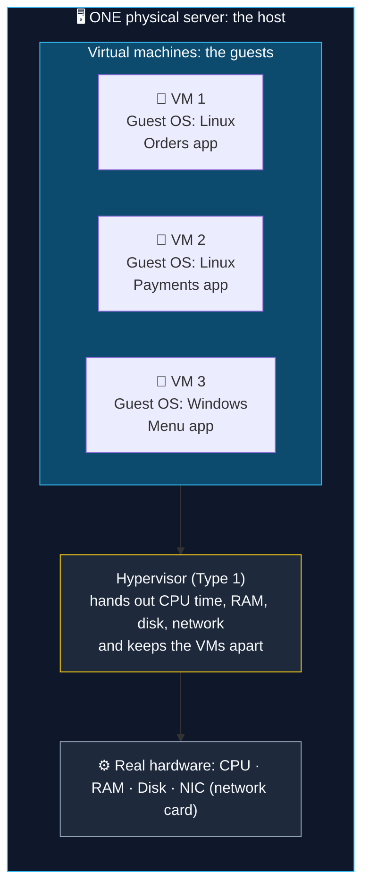

# Lesson 0.2 · Virtualization: One Server Becomes Many

> ⏱️ 18 min read · 🧪 15 min lab · 💰 $0.00 (read-only commands, nothing is created)
>
> 🎬 **Watch first:** [Cloud Evolution Timeline, Era 2](https://jyotipr45.github.io/aws-visual-architecture-mastery/visual-app/) (click any box or arrow in it to inspect it)
>
> 📖 **Interactive version of this lesson:** [open Lesson 0.2 in the app](https://jyotipr45.github.io/aws-visual-architecture-mastery/visual-app/#lesson-0.2) (try-it simulator, copy buttons, reveal-the-answer cards)

**The one idea of this lesson:** A thin layer of software called a hypervisor lets one physical computer pretend to be many separate computers (virtual machines). Same hardware, many apps, still kept apart. Every EC2 server you will ever launch in AWS is one of these virtual machines.

---

## 1. The story: FoodDash's 12 lonely servers (2005)

It's 2005. FoodDash survived Lesson 0.1 and grew. You now own 12 bare-metal servers, one app on each, because that was the safe rule. Your finance team looks at the bills and the CPU graphs, and asks a fair question:

```mermaid
flowchart LR
    S1["🖥️ 12 servers<br/>One app on each, every box about 10 to 15% busy."]
    S2["🧾 The bill hurts<br/>Power, cooling, space and repairs for 12 machines, 24 hours a day."]
    S3["💡 The big idea<br/>What if one box could pretend to be many computers?"]
    S4["🧩 Install a hypervisor<br/>Software that splits one server into many virtual machines (VMs)."]
    S5["📦 Move apps into VMs<br/>Each app gets its own VM with its own OS (P2V: physical to virtual)."]
    S6["✅ Switch off 9 boxes<br/>3 hosts now run all 12 VMs at about 50 to 70% busy."]
    S1 --> S2
    S2 --> S3
    S3 --> S4
    S4 --> S5
    S5 --> S6

    style S1 fill:#1e293b,stroke:#94a3b8,color:#f8fafc
    style S2 fill:#1e293b,stroke:#f87171,color:#f8fafc
    style S3 fill:#1e293b,stroke:#94a3b8,color:#f8fafc
    style S4 fill:#1e293b,stroke:#94a3b8,color:#f8fafc
    style S5 fill:#1e293b,stroke:#94a3b8,color:#f8fafc
    style S6 fill:#1e293b,stroke:#94a3b8,color:#f8fafc
```



Nothing about the apps changed. Orders still runs on Linux, Payments still runs on its own Linux, Menu still runs on Windows. Each one still believes it has a whole computer to itself. The difference is that three real machines are now doing the work of twelve.

The magic is the hypervisor. It sits between the hardware and the operating systems, hands out slices of CPU (Central Processing Unit) time, RAM (Random Access Memory), disk and network to each VM, and makes sure no VM can see or touch another VM's memory. A crash inside the Payments VM stays inside the Payments VM, exactly like when it had its own box.

Hold on to this picture, because it is literally how AWS works. When Amazon launched EC2 (Elastic Compute Cloud) in 2006, it was a giant pool of physical hosts running a hypervisor (Xen at first, AWS's own Nitro system today), renting out VMs by the hour. In AWS a VM is called an instance.



---

## 2. Every word, explained

| Word | Nickname / alias | What it means in plain English | Why it matters for FoodDash |
|---|---|---|---|
| **Virtualization** | virtualisation, server virtualization | Using software to make one physical computer behave like several separate computers. | Orders, Payments and Menu share one box but still behave as if each had its own. |
| **VM** | Virtual Machine, guest, instance (in AWS) | A pretend computer made of software. It has its own (virtual) CPU, RAM, disk and network card, and runs its own operating system. | The Orders app now lives in a VM instead of on a physical box. |
| **Host** | physical host, hypervisor host, node | The real, physical server that runs the hypervisor and the VMs on top of it. | 3 hosts now replace 12 old servers. |
| **Guest OS** | guest operating system | The operating system installed inside a VM. Each VM has its own, and they can be different (Linux in one, Windows in another). | Payments' Linux and Menu's Windows run side by side on one host. |
| **Hypervisor** | VMM, Virtual Machine Monitor | The software layer that creates VMs, shares the hardware between them, and keeps them isolated from each other. | The referee that makes sure the Menu VM can't read the Payments VM's memory. |
| **Type 1 hypervisor** | bare-metal hypervisor, native hypervisor | Installed directly on the hardware, with no normal OS underneath. Fast and used in data centers. Examples: VMware ESXi, Microsoft Hyper-V, Xen, KVM (Kernel-based Virtual Machine). | What you install on the 3 production hosts. |
| **Type 2 hypervisor** | hosted hypervisor | Runs as an ordinary app on top of a normal OS like Windows or macOS. Slower, but easy for laptops. Examples: Oracle VirtualBox, VMware Workstation. | What a developer uses to test FoodDash on a laptop. |
| **vCPU** | virtual CPU | A slice of a physical CPU given to a VM. In AWS, one vCPU is usually one thread of a physical core (a core with hyper-threading runs 2 threads). | A t3.micro gives the Orders VM 2 vCPUs. |
| **Isolation** | sandboxing | Keeping VMs separated so a crash, a virus or a memory leak in one cannot affect the others. | A bug in Menu can't crash Payments. |
| **Consolidation** | server consolidation | Moving many lightly used physical servers onto fewer, busier hosts. | 12 boxes at 12% become 3 hosts at about 58%. |
| **Overcommit** | oversubscription | Handing out more virtual CPUs or RAM than the host physically has, betting that not every VM is busy at the same moment. | Fine at 3 AM, risky on Diwali night. |
| **Noisy neighbour** | noisy neighbor | One VM using so much of the shared host that other VMs on the same host slow down. | A heavy sales report VM slows down live orders. |
| **Snapshot** | checkpoint | A saved copy of a VM's disk (and sometimes memory) at one moment, so you can roll back. | Take one before a risky upgrade of the Payments VM. |
| **Template** | golden image, AMI (Amazon Machine Image) in AWS | A ready-made VM disk with the OS and software already installed, used to create new identical VMs in minutes. | Every new Orders VM starts from the same tested template. |
| **Live migration** | vMotion (VMware's name) | Moving a running VM from one host to another without switching it off. | Repair a host at noon while customers keep ordering. |
| **P2V** | Physical to Virtual | Converting an app that ran on a physical server into a VM. | How the old Menu server became the Menu VM. |
| **VT-x / AMD-V** | hardware-assisted virtualization | Special CPU features from Intel (VT-x) and AMD (AMD-V) that make hypervisors fast. Usually switched on in BIOS / UEFI (the firmware settings). | Without them, VMs would be painfully slow. |
| **Nitro** | AWS Nitro System | AWS's own hypervisor plus custom hardware cards that do networking and storage work, so almost all of the host's power goes to your instances. | The layer under every modern FoodDash EC2 instance. |

---

## 3. How virtualization works, and what it fixed

### 🧠 How one machine is shared
The hypervisor gives each VM its own slice of every resource and makes each VM believe the slice is a whole computer.

| Real hardware | What the hypervisor does | What each VM sees |
|---|---|---|
| CPU cores | Gives each VM turns on the cores, many times per second (time-slicing) | Its own vCPUs |
| RAM | Reserves a separate block of memory per VM, walled off from the others | Its own RAM |
| Disk | Stores each VM's disk as a big file or volume | Its own hard disk |
| Network card (NIC) | Runs a virtual switch and gives each VM a virtual NIC with its own IP address | Its own network card |

### 🥊 Type 1 vs Type 2 hypervisors
Both create VMs. The difference is what sits underneath them.

|  | Type 1 (bare-metal) | Type 2 (hosted) |
|---|---|---|
| Runs on | Directly on the hardware | On top of Windows / macOS / Linux, like an app |
| Speed | Fast, very little overhead | Slower, two layers of OS |
| Used for | Data centers and clouds | Laptops, testing, learning |
| Examples | VMware ESXi, Hyper-V, Xen, KVM, AWS Nitro | VirtualBox, VMware Workstation |

### ✅ What got better
Utilization jumped from about 10 to 15% to about 50 to 70%, so you buy, power and cool far fewer boxes. Apps stay isolated, just like the one-app-per-server rule wanted. A new server takes minutes (clone a template) instead of weeks, as long as your hosts have spare room. Snapshots make risky changes reversible, and live migration lets you repair hardware without downtime.

### ⚠️ What it did NOT fix
You still buy the hosts upfront (CapEx), so you still guess how many you'll need: capacity planning just moved from servers to hosts. You still run your own data center. And new problems appeared: one host failure now takes down many VMs at once, hypervisor licences cost money, and VMs multiply out of control because they're so easy to create (VM sprawl). Lesson 0.3 removes the hosts from your life entirely.

### 🔗 How this became AWS EC2
Amazon had huge data centers full of virtualized hosts. In 2006 it started renting VMs from that pool to everyone: that's EC2 (Elastic Compute Cloud). The words map one to one, and you'll use them every day.

| Virtualization word | AWS word | Example |
|---|---|---|
| VM (virtual machine) | EC2 instance | Your Orders server |
| VM size (vCPUs + RAM) | Instance type | t3.micro = 2 vCPUs, 1 GiB RAM |
| Template / golden image | AMI (Amazon Machine Image) | Amazon Linux 2023 AMI |
| Hypervisor | Nitro (older types: Xen) | Hidden from you, managed by AWS |
| Physical server, no hypervisor | Bare-metal instance (*.metal) | m5.metal |

> 🎛️ **Try it live:** the [interactive version of this lesson](https://jyotipr45.github.io/aws-visual-architecture-mastery/visual-app/#lesson-0.2) has a simulator for this section. Drag the sliders and watch the numbers change.

---

## 4. 🧪 Hands-on lab: find the hypervisors on your laptop and inside AWS

**Goal:** Check whether your own CPU can run VMs, meet a real VM already on Windows (WSL2), then ask AWS which hypervisor runs its instances.  
**Cost:** $0.00. Every AWS command here is a read-only “describe” call: free, and nothing is created.  
**Where:** Windows PowerShell, plus the AWS CLI (Command Line Interface) logged in as your IAM user.

**Before you start:**

- AWS CLI v2 is installed: aws --version prints aws-cli/2.x.
- aws sts get-caller-identity shows your IAM user ARN (arn:aws:iam::<account-id>:user/...), not :root.

### Step 1: Can your CPU run virtual machines?

```powershell
# VirtualizationFirmwareEnabled = True means Intel VT-x / AMD-V is switched on in BIOS/UEFI
# SecondLevelAddressTranslationExtensions = True means the CPU can translate VM memory in hardware (fast VMs)
Get-CimInstance Win32_Processor | Select-Object Name, VirtualizationFirmwareEnabled, SecondLevelAddressTranslationExtensions

# Is a hypervisor already running underneath Windows right now?
(Get-CimInstance Win32_ComputerSystem).HypervisorPresent
```

Surprise: if HypervisorPresent is True, Windows itself is already running on top of Microsoft's Hyper-V hypervisor (it switches on for WSL2, Docker Desktop or Windows security features). In that case VirtualizationFirmwareEnabled can show False, because the hypervisor has taken the feature for itself and hides it from Windows. Your laptop is already a host, and your Windows is a special guest.

### Step 2: Meet a real VM on your laptop (WSL2)

```powershell
# WSL2 (Windows Subsystem for Linux, version 2) runs a real Linux kernel inside a lightweight Hyper-V VM
wsl --status
wsl -l -v

# Ask the Linux guest which kernel it runs
wsl uname -r
```

Expected output:
```text
5.15.167.4-microsoft-standard-WSL2
```

The kernel name ends with microsoft-standard-WSL2: a Linux guest OS running in a VM next to your Windows, on the same hardware. That's virtualization on your own desk. If WSL isn't installed, just read along: installing it needs admin rights and a restart, and you don't need it for this course yet. (Your kernel version number will differ.)

### Step 3: Ask AWS which hypervisor runs its instances

```powershell
aws ec2 describe-instance-types `
  --instance-types t2.micro t3.micro m5.large `
  --query "InstanceTypes[].{Type:InstanceType,vCPUs:VCpuInfo.DefaultVCpus,MemoryMiB:MemoryInfo.SizeInMiB,Hypervisor:Hypervisor,BareMetal:BareMetal}" `
  --output table
```

Expected output:
```text
---------------------------------------------------------------
|                    DescribeInstanceTypes                    |
+-----------+-------------+------------+------------+---------+
| BareMetal | Hypervisor  | MemoryMiB  |   Type     | vCPUs   |
+-----------+-------------+------------+------------+---------+
|  False    |  xen        |  1024      |  t2.micro  |  1      |
|  False    |  nitro      |  1024      |  t3.micro  |  2      |
|  False    |  nitro      |  8192      |  m5.large  |  2      |
+-----------+-------------+------------+------------+---------+
```

Read it like this: each row is a VM size you can rent. Older types like t2 run on the Xen hypervisor; newer ones run on Nitro, AWS's own hypervisor. MemoryMiB is RAM in mebibytes (1024 MiB = 1 GiB). The backtick character (the key left of 1) at the end of a line tells PowerShell the command continues on the next line. Row order may differ, and the region is the default one you set in aws configure.

### Step 4: AWS still rents whole physical servers

```powershell
# Instance types with NO hypervisor: you get the entire physical machine
aws ec2 describe-instance-types `
  --filters Name=bare-metal,Values=true `
  --query "InstanceTypes[0:5].[InstanceType,VCpuInfo.DefaultVCpus,MemoryInfo.SizeInMiB]" `
  --output table
```

You'll see names ending in .metal (like m5.metal or c5.metal) with huge vCPU and RAM numbers: that's one whole host. People rent these for software licensed per physical CPU, for special performance needs, or to run their own hypervisor. So bare metal from Lesson 0.1 never died; it just became rentable.

### Step 5: Do FoodDash's consolidation math

```powershell
$apps       = 12   # old bare-metal servers, one app each
$appCpu     = 12   # % CPU each app really uses
$target     = 70   # % CPU we're happy to run a host at
$hvOverhead = 10   # % CPU the hypervisor itself uses

$hosts = [math]::Ceiling(($apps * $appCpu) / ($target - $hvOverhead))

"Hosts needed         : $hosts"
"Servers switched off : $($apps - $hosts)"
"Host CPU now         : $([math]::Round(($apps * $appCpu) / $hosts + $hvOverhead)) %"
```

Expected output:
```text
Hosts needed         : 3
Servers switched off : 9
Host CPU now         : 58 %
```

Twelve boxes become three. Change $appCpu to 30 and run it again: busier apps need more hosts, so consolidation saves less. The simulator above lets you drag the same numbers.

---

## 5. 🤔 What happens if...?

Think about your answer first, then click to reveal it.

<details>
<summary><b>1. ...the host running 6 of FoodDash's VMs has a motherboard failure?</b></summary>

All 6 VMs go down at the same moment. Consolidation saves money, but it puts more eggs in one basket (a bigger “blast radius”). That's why real setups run a cluster of hosts with high availability (HA): the VMs are restarted on a healthy host within minutes. In AWS you'll spread instances across Availability Zones (separate data centers) so one failure never stops FoodDash.
</details>

<details>
<summary><b>2. ...a badly written sales-report VM uses 100% of its CPU all day?</b></summary>

It can only use the vCPUs it was given, so it can't steal another VM's memory or crash it. But if the host was overcommitted, the other VMs wait longer for their turn on the real cores and everything feels slow: the noisy-neighbour problem. Fixes: CPU limits per VM, moving the heavy VM to another host, or (in AWS) choosing the right instance type.
</details>

<details>
<summary><b>3. ...you hand out 32 vCPUs on a host that only has 16 hardware threads?</b></summary>

That's overcommit, and it usually works, because most VMs are mostly idle. The day they all get busy together (Diwali!), each VM waits for its turn and response times jump. You haven't escaped capacity planning; you've moved it from servers to hosts.
</details>

<details>
<summary><b>4. ...a developer needs a fresh test server today?</b></summary>

If a host has spare room: clone the template VM and they have a server in minutes. If every host is full, you're back to Lesson 0.1: order a new host and wait weeks. The cloud's answer is a pool of hosts so large that, from your point of view, it is never full.
</details>

---

## 6. 🧹 Cleanup (mandatory)

1. Nothing was created in AWS: describe-instance-types only reads information, and read calls are free.
2. If you started WSL just for this lab, stop its VM to free RAM: wsl --shutdown
3. Habit check: AWS Console → Billing and Cost Management → Bills shows $0.00 for this month.

✅ Done. Nothing was created, bill: $0.00.

---

## 7. Key takeaways

- A hypervisor splits one physical host into many isolated virtual machines (VMs), each with its own guest OS.
- Type 1 hypervisors run directly on hardware (data centers, AWS Nitro); Type 2 run as an app on your laptop (VirtualBox).
- Virtualization raised utilization from about 10 to 15% to about 50 to 70% and made new servers a matter of minutes.
- It did not remove buying hardware, capacity planning or running a data center; it moved those problems to the hosts.
- An EC2 instance is a VM on AWS's hosts: instance type = VM size, AMI = template. Next: “What if you didn't have to own the hosts at all?”

---

⬅️ [Lesson 0.1: Bare-metal servers](./lesson-0.1-bare-metal-servers.md) · [Module 00 overview](./README.md) · ➡️ **Next:** Lesson 0.3: Cloud computing and elastic scaling
