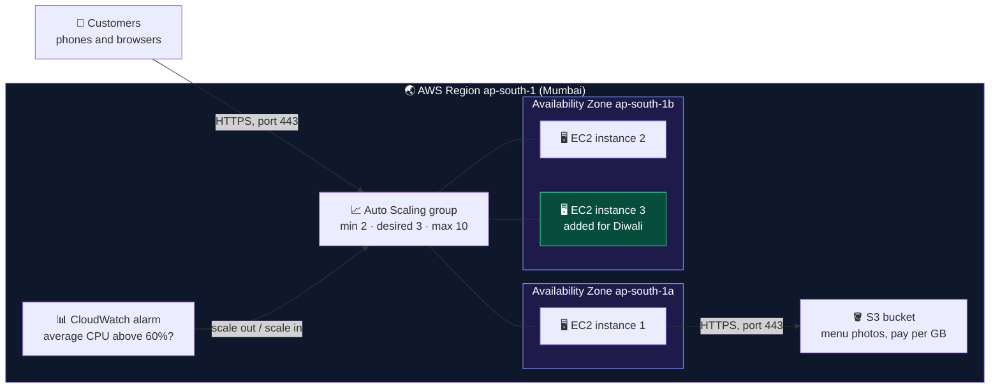

# Lesson 0.3 · Cloud Computing: Rent It by the Second

> ⏱️ 20 min read · 🧪 20 min lab · 💰 $0.00 (a tiny S3 file you delete at the end, plus a free budget alarm)
>
> 🎬 **Watch first:** [Cloud Evolution Timeline, Era 3](https://jyotipr45.github.io/aws-visual-architecture-mastery/visual-app/) (click any box or arrow in it to inspect it)
>
> 📖 **Interactive version of this lesson:** [open Lesson 0.3 in the app](https://jyotipr45.github.io/aws-visual-architecture-mastery/visual-app/#lesson-0.3) (try-it simulator, copy buttons, reveal-the-answer cards)

**The one idea of this lesson:** Stop owning hosts. Rent virtual machines and storage from a provider's giant pool, start them in a minute, add more when orders spike, remove them when it's quiet, and pay only for what you used. That's cloud computing, and the “grow and shrink automatically” part is called elastic scaling.

---

## 1. The story: FoodDash meets AWS

In Lesson 0.2 you still had to buy hosts and guess how many. Meanwhile, Amazon had thousands of virtualized hosts and a simple idea: rent them out over the internet, by the hour, to anyone with a credit card. Here's FoodDash's first Diwali in the cloud:

```mermaid
flowchart LR
    S1["☁️ AWS opens<br/>2006: S3 (March) and EC2 (August) let anyone rent storage and servers."]
    S2["💳 Sign up<br/>No contract, no minimum, no hardware. An account takes minutes."]
    S3["🖱️ Launch servers<br/>One command and an EC2 instance is running in about a minute."]
    S4["📈 Diwali rush<br/>Auto Scaling notices busy CPUs and adds servers automatically."]
    S5["📉 Rush ends<br/>It removes the extra servers again, and you stop paying for them."]
    S6["🧾 Monthly bill<br/>You pay only for server-hours and gigabytes actually used (OpEx)."]
    S1 --> S2
    S2 --> S3
    S3 --> S4
    S4 --> S5
    S5 --> S6

    style S1 fill:#1e293b,stroke:#94a3b8,color:#f8fafc
    style S2 fill:#1e293b,stroke:#94a3b8,color:#f8fafc
    style S3 fill:#1e293b,stroke:#94a3b8,color:#f8fafc
    style S4 fill:#1e293b,stroke:#94a3b8,color:#f8fafc
    style S5 fill:#1e293b,stroke:#94a3b8,color:#f8fafc
    style S6 fill:#1e293b,stroke:#94a3b8,color:#f8fafc
```



Look at what disappeared: no buying hardware, no room, no power or cooling, no waiting weeks, and no guessing how many servers Diwali needs. The Diwali problem from Lesson 0.1 (buy 1 and crash, or buy 10 and waste) simply goes away, because the number of servers now follows the number of orders, hour by hour.

Under the hood it is exactly Lesson 0.2: AWS runs huge numbers of physical hosts with the Nitro hypervisor and rents you VMs (EC2 instances) and storage (S3) from that pool. The pool is so large that, for you, it is never full. That's what “the cloud” really means: someone else's data centers, used through the internet and an API (Application Programming Interface).

The money changes too. Instead of a big upfront purchase (CapEx) you get a monthly bill for what you used (OpEx). Experimenting becomes cheap: try an idea for ₹5 worth of server time, and if it fails, delete it.



---

## 2. Every word, explained

| Word | Nickname / alias | What it means in plain English | Why it matters for FoodDash |
|---|---|---|---|
| **Cloud computing** | the cloud | Renting computing power, storage and services over the internet from a provider, on demand, and paying only for what you use. | FoodDash runs in AWS's data centers instead of your own server room. |
| **AWS** | Amazon Web Services | Amazon's cloud. Started in 2006 with S3 and EC2, now offers 200+ services. | The provider FoodDash rents everything from. |
| **Region** | AWS Region, e.g. ap-south-1 | A geographic area with its own set of data centers, fully separate from other Regions. Named by code: ap-south-1 = Asia Pacific (Mumbai), ap-south-2 = Hyderabad, us-east-1 = N. Virginia. | Run in Mumbai so Indian customers get fast responses and data stays in India. |
| **AZ** | Availability Zone, e.g. ap-south-1a | One or more separate data centers inside a Region, with their own power, cooling and network, a few kilometres apart and joined by fast private links. | Run servers in 2 AZs so one flooded building doesn't stop orders. |
| **Edge location** | PoP, Point of Presence | Small AWS sites in hundreds of cities that cache content close to users. Used by CloudFront (Tier 1). | Menu photos load fast in Bhubaneswar even though servers are in Mumbai. |
| **EC2** | Elastic Compute Cloud, instance, virtual server | AWS's service for renting VMs (Lesson 0.2) by the second. | Where the Java order service runs in this era. |
| **S3** | Simple Storage Service, bucket, object storage | Unlimited file storage. You put files (objects) into folders called buckets and pay per GB stored per month. | Stores menu photos and the website files. |
| **Bucket** | S3 bucket | A named container for files in S3. The name must be unique across all AWS accounts in the world. | fooddash-menu-photos holds every dish picture. |
| **ARN** | Amazon Resource Name | AWS's full address for any resource. Format: arn:partition:service:region:account-id:resource. Some parts are blank when they don't apply. | arn:aws:s3:::fooddash-menu-photos (S3 bucket names are global, so region and account are blank). |
| **On-demand** | pay-as-you-go | Start and stop resources whenever you like, with no contract, billed per second or per hour. | Launch extra servers only for the Diwali weekend. |
| **Elasticity** | elastic scaling | Capacity grows and shrinks automatically to match demand, like a rubber band. | 2 servers at 3 AM, 10 during the dinner rush. |
| **Scale out / in** | horizontal scaling | Add more servers (out) or remove servers (in). The cloud's favourite way to grow. | Add 3 more order servers during the IPL final. |
| **Scale up / down** | vertical scaling | Make one server bigger (more CPU and RAM) or smaller. Has a ceiling and usually needs a restart. | Move the database from 2 to 8 vCPUs. |
| **Auto Scaling group** | ASG | A set of identical EC2 instances that AWS keeps between a minimum and a maximum count, adding or removing them based on rules. Desired = how many it should run right now. | min 2, desired 3, max 10 order servers. |
| **CloudWatch** | Amazon CloudWatch, metrics and alarms | AWS's monitoring service. It collects numbers (metrics) like CPU % and fires an alarm when a number crosses a line. | “Average CPU above 60% for 2 minutes” tells the ASG to add a server. |
| **OpEx** | Operating Expenditure | Paying regularly for what you use, instead of buying upfront (CapEx). | A monthly AWS bill instead of buying 10 servers. |
| **IaaS / PaaS / SaaS** | Infrastructure / Platform / Software as a Service | Three levels of cloud service: rent raw servers (IaaS), rent a ready platform to run your code (PaaS), or rent finished software (SaaS). | EC2 is IaaS, Elastic Beanstalk is PaaS, Gmail for the support team is SaaS. |
| **Shared responsibility model** | security of vs in the cloud | AWS secures the cloud itself (buildings, hardware, hypervisor). You secure what you put in it (your OS, code, data, passwords, access keys). | AWS guards the Mumbai data center; you must patch the EC2 OS and protect your keys. |
| **Free Tier** | AWS Free Tier, free plan | Free usage allowances. Some are always free (like Lambda's 1 million requests per month); newer accounts also get free credits for a limited time. | Lets you learn with a bill of $0.00 if you clean up. |
| **AWS Budgets** | budget alarm, zero spend budget | Sends you an email when your spending crosses a limit. Budgets without automatic actions are free. | Your smoke alarm for surprise bills. |

---

## 3. What makes it a cloud, and how the pieces fit

### 📜 The 5 things that make something a “cloud”
The official definition (from NIST, the US National Institute of Standards and Technology) lists five characteristics. If one is missing, it's just someone else's server.

| Characteristic | Plain English | In AWS |
|---|---|---|
| On-demand self-service | Get resources yourself, no human approval | aws ec2 run-instances, no phone call |
| Broad network access | Reach it over the internet from anywhere | Console, CLI, APIs over HTTPS (port 443) |
| Resource pooling | Many customers share one huge pool | Nitro hosts shared by many accounts, safely isolated |
| Rapid elasticity | Grow and shrink fast | Auto Scaling adds servers in minutes |
| Measured service | Usage is metered and billed | Per-second EC2 billing, per-GB S3 billing |

### 🍰 IaaS, PaaS, SaaS: who manages what
The higher you go, the less you manage and the less you can customise. FoodDash will use all three.

| Layer | On-premises | IaaS (EC2) | PaaS (Elastic Beanstalk) | SaaS (Gmail) |
|---|---|---|---|---|
| Your app code and data | You | You | You | Provider |
| Runtime (Java 17) | You | You | Provider | Provider |
| Operating system | You | You | Provider | Provider |
| Virtualization | You | AWS | AWS | Provider |
| Servers, storage, network | You | AWS | AWS | Provider |
| Building, power, cooling | You | AWS | AWS | Provider |

### 🌏 Regions, Availability Zones and edge locations
AWS's map has three levels. You choose the Region; you spread your servers across AZs; edge locations speed up content for faraway users.

| Level | What it is | FoodDash example |
|---|---|---|
| Region | A geographic area, fully independent | ap-south-1 (Mumbai) |
| Availability Zone | Separate data center(s) inside a Region | ap-south-1a, ap-south-1b, ap-south-1c |
| Edge location | Small cache site near users | Serves menu photos in Kolkata and Bengaluru |

### 📈 Elastic scaling: how the Diwali problem disappears
An Auto Scaling group keeps between a minimum and a maximum number of identical servers. CloudWatch watches a number such as average CPU. When CPU stays above, say, 60%, the group launches another instance from the same template (scale out). When CPU stays low, it terminates one (scale in). The minimum (2) keeps FoodDash alive even at 3 AM and across 2 AZs; the maximum (10) caps your bill. Drag the simulator below: the green line follows demand, the red line is what you'd have bought in Lesson 0.1.

### 🤝 Shared responsibility: who protects what
Moving to the cloud doesn't move all the work to AWS. Security is split down the middle.

| AWS is responsible for (security OF the cloud) | You are responsible for (security IN the cloud) |
|---|---|
| Data center buildings, guards, power | Who can log in (IAM users, MFA, access keys) |
| Physical servers, disks, network cables | Patching the operating system on your EC2 instances |
| The hypervisor (Nitro) and isolation between customers | Your app code, firewall rules (security groups), and data |
| Global network between Regions | Not committing secrets to GitHub, encrypting sensitive data |

### ⚠️ What the cloud did NOT fix
You still patch and babysit the operating system on every EC2 instance. Apps still behave differently on a developer laptop than on the server (“it works on my machine!”), which Lesson 0.4 fixes. Even with Auto Scaling, the minimum servers run and cost money at 3 AM when nobody orders, which Lesson 0.5 fixes. And a resource you forget to delete keeps billing every second, which is why every lab here ends with cleanup.

> 🎛️ **Try it live:** the [interactive version of this lesson](https://jyotipr45.github.io/aws-visual-architecture-mastery/visual-app/#lesson-0.3) has a simulator for this section. Drag the sliders and watch the numbers change.

---

## 4. 🧪 Hands-on lab: set a cost alarm, explore AWS's map, rent storage by the byte

**Goal:** Create a free alarm that emails you if anything starts costing money, see the Regions and Availability Zones your account can use, then create, use and delete an S3 bucket: the cloud's pay-for-what-you-use idea, for real.  
**Cost:** $0.00. AWS Budgets without actions is free. The S3 file is 34 bytes for a few minutes: far less than one hundredth of a cent, and you delete it in Cleanup.  
**Where:** AWS Console in your browser (Step 1), then Windows PowerShell with the AWS CLI logged in as your IAM user (Steps 2 to 4).

**Before you start:**

- Sign in to the AWS Console as your IAM user (not root).
- aws sts get-caller-identity in PowerShell shows the same IAM user.
- Keep this PowerShell window open until Cleanup: Step 3 saves the bucket name in a variable.

### Step 1: Create a Zero spend budget (your smoke alarm)

```text
AWS Console → search bar → type "Budgets" → open Billing and Cost Management → Budgets
1. Click "Create budget"
2. Choose "Use a template (simplified)"
3. Choose the template "Zero spend budget"
4. Budget name: fooddash-zero-spend
5. Email recipients: your email address
6. Click "Create budget"
```

From now on, AWS emails you as soon as your account spends even one cent beyond the Free Tier. Budgets without automatic actions are free, so you keep this one forever: it is NOT part of the cleanup. Every lab from here on is protected by it.

### Step 2: See AWS's map from your terminal

```powershell
# How many Regions can your account use right now?
aws ec2 describe-regions --query "length(Regions)"

# The Availability Zones inside Mumbai (ap-south-1)
aws ec2 describe-availability-zones `
  --region ap-south-1 `
  --query "AvailabilityZones[].[ZoneName,ZoneId,State]" `
  --output table
```

Expected output:
```text
17
-------------------------------------------
|        DescribeAvailabilityZones        |
+-------------+------------+--------------+
|  ap-south-1a|  aps1-az1  |  available   |
|  ap-south-1b|  aps1-az3  |  available   |
|  ap-south-1c|  aps1-az2  |  available   |
+-------------+------------+--------------+
```

Mumbai has 3 Availability Zones. Look closely at the two names: ZoneName (ap-south-1a) is shuffled differently for every AWS account, so your “1a” may be someone else's “1b”. ZoneId (aps1-az1) always points to the same physical place. Use ZoneId when you compare with another team. The Region count (17 here) depends on which optional Regions your account has switched on, so yours may differ. Both calls only read information, so they're free.

### Step 3: Rent storage by the byte with S3

```powershell
# Bucket names must be unique in the whole world, so add a random number
$bucket = "fooddash-lab-" + (Get-Random -Minimum 100000 -Maximum 999999)
$bucket          # write this name down, you need it for cleanup

# mb = make bucket, in the Mumbai Region
aws s3 mb "s3://$bucket" --region ap-south-1

# Make a tiny menu file and upload it (cp = copy)
"Masala Dosa,120`nPaneer Tikka,180" | Set-Content -Encoding ascii menu.csv
aws s3 cp menu.csv "s3://$bucket/menu.csv"

# ls = list what's in the bucket
aws s3 ls "s3://$bucket"

# The bucket's full AWS address (ARN)
"arn:aws:s3:::$bucket"
```

Expected output:
```text
fooddash-lab-482913
make_bucket: fooddash-lab-482913
upload: .\menu.csv to s3://fooddash-lab-482913/menu.csv
2026-11-25 14:32:10         34 menu.csv
arn:aws:s3:::fooddash-lab-482913
```

You just rented storage with no disk to buy and no size to choose. S3 grows from 34 bytes to petabytes without you doing anything, and the price (S3 Standard in Mumbai: $0.025 per GB per month, plus a fraction of a cent per thousand requests) is charged only for what's stored. Read the ARN: arn (it's an ARN) : aws (partition) : s3 (service) : (no region) : (no account) : bucket name. S3 bucket names are global, so region and account are left blank. Open S3 in the Console and you'll see your bucket and file there too. Your random number and timestamp will differ.

### Step 4: Do FoodDash's Auto Scaling math for one day

```powershell
# Orders per minute for each hour of a normal day (0:00 to 23:00)
$day = 20,10,6,5,5,8,20,45,70,80,95,150,260,230,140,100,110,170,260,380,420,330,180,70
$perServer = 100          # orders per minute one server can handle
$price     = 0.0112       # USD per hour, t3.micro Linux on-demand in Mumbai

$peak    = ($day | Measure-Object -Maximum).Maximum
$fixed   = [math]::Ceiling($peak / $perServer) * 24                      # Lesson 0.1: buy for the peak, run all day
$elastic = ($day | ForEach-Object { [math]::Max(1, [math]::Ceiling($_ / $perServer)) } | Measure-Object -Sum).Sum

"Fixed fleet server-hours  : $fixed"
"Auto Scaling server-hours : $elastic"
"Saved                     : $([math]::Round((1 - $elastic / $fixed) * 100, 1)) %"
"Cost per day, fixed       : $" + ($fixed * $price).ToString("0.00")
"Cost per day, elastic     : $" + ($elastic * $price).ToString("0.00")
```

Expected output:
```text
Fixed fleet server-hours  : 120
Auto Scaling server-hours : 45
Saved                     : 62.5 %
Cost per day, fixed       : $1.34
Cost per day, elastic     : $0.50
```

A server-hour is one server running for one hour; it's what EC2 bills you for. Buying for the 9 PM peak (5 servers × 24 hours) wastes almost two thirds of your money; following demand hour by hour doesn't. In real life you'd keep a minimum of 2 servers in 2 AZs for safety, so the saving is a bit smaller, but the idea holds. Try $day values multiplied by 5 for Diwali in the simulator above.

---

## 5. 🤔 What happens if...?

Think about your answer first, then click to reveal it.

<details>
<summary><b>1. ...Diwali orders jump 10x within 15 minutes?</b></summary>

CloudWatch sees CPU climb, the Auto Scaling group launches more instances, and each takes a minute or two to boot and become ready. For a jump that sharp, you'd add a scheduled action to scale out the evening before, because you already know when Diwali is. One more gotcha: new AWS accounts have small service quotas (limits), such as how many vCPUs of on-demand instances you may run. Ask for a quota increase days before a big event, not during it.
</details>

<details>
<summary><b>2. ...the whole ap-south-1a Availability Zone loses power?</b></summary>

If FoodDash runs only in ap-south-1a, it goes down. If the Auto Scaling group spans ap-south-1a and ap-south-1b, the instances in 1b keep serving, and the group launches replacements in the healthy AZ. That's why the minimum is 2, spread across 2 AZs: the cloud doesn't stop failures, it makes surviving them cheap.
</details>

<details>
<summary><b>3. ...you forget the lab bucket for a whole year?</b></summary>

34 bytes for a year costs a tiny fraction of a cent, so the bill stays at $0.00. But the habit is what matters: forget an m5.large EC2 instance instead (about $0.096 per hour in us-east-1) and that's roughly $70 a month, every month, until you notice. The Zero spend budget from Step 1 is there to catch exactly that.
</details>

<details>
<summary><b>4. ...someone finds your AWS access keys in a public GitHub repo?</b></summary>

Bots scan GitHub for keys within minutes. They can launch huge instances (often for crypto mining) and you pay. This is your side of the shared responsibility model: never commit keys (this repo's .gitignore blocks the usual files), use an IAM user with only the permissions it needs, turn on MFA, and if keys leak, deactivate them in IAM immediately.
</details>

<details>
<summary><b>5. ...AWS itself has a problem in the Mumbai Region?</b></summary>

It happens rarely, but it happens. Regions are built to be independent, so a problem in ap-south-1 doesn't spread to ap-south-2 (Hyderabad). Very critical systems run in two Regions and can switch over. The AWS Health Dashboard shows what's affected. The cloud is still someone else's computers, so design FoodDash expecting parts to fail.
</details>

---

## 6. 🧹 Cleanup (mandatory)

1. Delete the file and the bucket in one go (--force empties it first): aws s3 rb "s3://$bucket" --force
2. Check it's gone: aws s3 ls should no longer list fooddash-lab-... (if you closed PowerShell, find the name with aws s3 ls and use it in the command above).
3. Delete the local file: Remove-Item menu.csv
4. Do NOT delete the fooddash-zero-spend budget: it's free and protects every future lab.
5. Habit check: AWS Console → Billing and Cost Management → Bills shows $0.00 for this month.

✅ Done. Bucket deleted, budget alarm armed, bill: $0.00.

---

## 7. Key takeaways

- Cloud computing = renting computing, storage and services over the internet, on demand, paying only for what you use (OpEx, not CapEx).
- AWS's map: Regions (ap-south-1 Mumbai) contain Availability Zones (ap-south-1a/b/c); edge locations sit close to users.
- Elastic scaling with an Auto Scaling group and a CloudWatch alarm makes capacity follow demand, which ends the Lesson 0.1 Diwali dilemma.
- IaaS, PaaS and SaaS differ in how much you manage; security is shared: AWS secures the cloud, you secure what you put in it.
- Still unsolved: OS babysitting, “works on my machine” and paying for idle minimum servers. Next: “What if the app carried its whole environment with it?”

---

⬅️ [Lesson 0.2: Virtualization](./lesson-0.2-virtualization-and-hypervisors.md) · [Module 00 overview](./README.md) · ➡️ **Next:** [Lesson 0.4: Microservices and containers](./lesson-0.4-microservices-and-containers.md)
