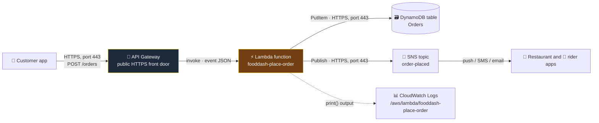

# Lesson 0.5 · Serverless: Code That Runs Only When an Order Arrives

> ⏱️ 22 min read · 🧪 25 min lab · 💰 $0.00 (a few Lambda calls, well inside the always-free 1 million requests per month)
>
> 🎬 **Watch first:** [Cloud Evolution Timeline, Era 5](https://jyotipr45.github.io/aws-visual-architecture-mastery/visual-app/) (click any box or arrow in it to inspect it)
>
> 📖 **Interactive version of this lesson:** [open Lesson 0.5 in the app](https://jyotipr45.github.io/aws-visual-architecture-mastery/visual-app/#lesson-0.5) (try-it simulator, copy buttons, reveal-the-answer cards)

**The one idea of this lesson:** Write just the function that handles one thing (“place an order”) and hand it to AWS. AWS runs it only when an event happens, runs as many copies as needed at the same moment, and bills you per request and per millisecond. No servers, no OS, no containers to manage, and an empty night costs nothing.

---

## 1. The story: the 3 AM problem (2014 onwards)

FoodDash runs on containers now, and Diwali is easy. But the finance team still asks why the bill shows servers running all night when almost nobody orders. Here's the last revolution of Module 00:

```mermaid
flowchart LR
    S1["🌙 3 AM, 5 orders<br/>Containers still run all night, and bill all night."]
    S2["💡 The idea<br/>Run code only when something happens (an event)."]
    S3["⚡ Write a function<br/>Just the “place order” code. No server, OS or container to manage."]
    S4["🚪 Connect an event<br/>API Gateway turns each HTTPS request into an event that wakes Lambda."]
    S5["📈 Diwali: 1,000 at once<br/>Lambda runs 1,000 copies side by side, automatically."]
    S6["🧾 Pay per call<br/>Billed per request and per millisecond. 3 AM costs almost nothing."]
    S1 --> S2
    S2 --> S3
    S3 --> S4
    S4 --> S5
    S5 --> S6

    style S1 fill:#1e293b,stroke:#f87171,color:#f8fafc
    style S2 fill:#1e293b,stroke:#94a3b8,color:#f8fafc
    style S3 fill:#1e293b,stroke:#94a3b8,color:#f8fafc
    style S4 fill:#1e293b,stroke:#94a3b8,color:#f8fafc
    style S5 fill:#1e293b,stroke:#94a3b8,color:#f8fafc
    style S6 fill:#1e293b,stroke:#94a3b8,color:#f8fafc
```



AWS announced Lambda in November 2014. The pitch was simple: upload a function, say which event should trigger it, and stop thinking about servers. There are still servers, of course (Lambda runs on AWS's Firecracker micro-VMs, a direct descendant of Lesson 0.2), but they're AWS's problem: patching, scaling, capacity and availability across Availability Zones are all handled for you.

Serverless is also event-driven: nothing runs until something happens. A customer taps “Place order” (an HTTPS request), a photo lands in S3, a message arrives in a queue, a clock strikes midnight. Each event wakes exactly the code that cares about it, and when the work is done, the code goes back to sleep.

That flips the cost model one last time. Lesson 0.1: pay upfront for peak capacity. Lesson 0.3: pay per server-hour. Lesson 0.5: pay per request. When FoodDash is quiet, the compute bill is close to zero; when it's busy, the bill grows with the orders, which is exactly when FoodDash is earning money.



---

## 2. Every word, explained

| Word | Nickname / alias | What it means in plain English | Why it matters for FoodDash |
|---|---|---|---|
| **Serverless** | no-ops compute | A way of running code where the provider manages all servers, scaling and availability, and you pay only while your code runs. The servers still exist; you just never see them. | The place-order code runs without a single server for you to patch. |
| **FaaS** | Function as a Service | The serverless model for code: you upload small functions and the platform runs them on events. | Lambda is AWS's FaaS. |
| **Lambda** | AWS Lambda | AWS's service that runs your function when an event arrives. Supports Python, Java, Node.js, .NET, Go, Ruby and container images. | fooddash-place-order is a Lambda function. |
| **Function** | Lambda function | Your uploaded code plus its settings: runtime, memory, timeout and permissions (execution role). | 128 MB memory, 10-second timeout, Python 3.13 in this lab. |
| **Handler** | entry point | The exact method Lambda calls, written as file.method. It receives the event and a context object. | app.handler means the handler() method inside app.py. |
| **Event** | trigger payload | A small JSON document describing what happened, passed to your handler. | {"item": "Masala Dosa", "qty": 2} |
| **Event-driven** | event-driven architecture, EDA | A design where parts of the system react to events instead of constantly asking (polling) whether something happened. | Order placed → notify restaurant → assign rider, each step triggered by the last. |
| **Trigger** | event source | The AWS service that sends events to a function: API Gateway, S3, SQS, EventBridge, DynamoDB Streams and more. | API Gateway is the trigger for place-order. |
| **Invocation** | call, request | One run of a function. Synchronous: the caller waits for the answer. Asynchronous: the caller hands off the event and moves on. | Placing an order is synchronous; sending the receipt email is asynchronous. |
| **Cold start** | init | The extra delay on a call that needs a brand-new execution environment (download code, start the runtime). Later calls reuse a warm one. | The first order after a quiet night takes a little longer. |
| **Concurrency** | concurrent executions | How many copies of a function run at the same instant. Each Region has a quota (often 1,000 by default; brand-new accounts can start lower). | 1,000 Diwali orders in the same second = 1,000 copies at once. |
| **Timeout** | max duration | The longest one invocation may run before Lambda stops it. You choose it, up to 15 minutes. | 10 seconds is plenty for placing an order. |
| **Memory setting** | memory size | From 128 MB to 10,240 MB. CPU power grows with memory, and you pay per GB-second. | Give the Java version 1,024 MB so it starts faster. |
| **GB-second** | GB-s | Lambda's compute unit: memory in GB × seconds run. 128 MB for 1 second = 0.125 GB-s. | 1 million orders × 0.1 s × 0.5 GB = 50,000 GB-s, inside the free 400,000. |
| **API Gateway** | Amazon API Gateway | A managed HTTPS front door (port 443) that receives web requests and passes them to Lambda or other back ends, with throttling and authentication. | https://api.fooddash.com/orders lands here first. |
| **DynamoDB** | Amazon DynamoDB | AWS's serverless NoSQL database: no servers, scales automatically, pay per request or per capacity. | The Orders table, written by place-order. |
| **SNS** | Amazon Simple Notification Service, pub/sub | Publish one message to a topic and every subscriber (apps, email, SMS, other functions) gets a copy. | order-placed alerts the restaurant and the rider app at once. |
| **Execution role** | IAM role for Lambda | The IAM role a function wears while it runs. Its trust policy lets lambda.amazonaws.com use it; its permission policies say what the function may do. | fooddash-lambda-lab-role may only write logs. |
| **CloudWatch Logs** | log group, log stream | Where Lambda sends everything your code prints, plus a REPORT line per call with duration and memory used. Log group name: /aws/lambda/<function-name>. | /aws/lambda/fooddash-place-order-lab shows every order. |
| **Firecracker** | micro-VM | AWS's open-source, tiny virtual machine technology that isolates each Lambda execution environment. It starts in a fraction of a second. | Each FoodDash function copy runs in its own micro-VM. |

---

## 3. How serverless works, and when it's the right choice

### 🍽️ What “serverless” really means
A service counts as serverless when all four of these are true. Lambda, API Gateway, DynamoDB, S3 and SNS all qualify.

| Trait | Plain English | FoodDash effect |
|---|---|---|
| No servers to manage | No OS, patching or capacity sizing | Nobody on the team logs in to a server |
| Scales automatically | From zero copies to thousands and back | Diwali needs no planning meeting |
| Pay for value | Per request and per millisecond, not per hour | 3 AM costs almost nothing |
| Highly available by default | Runs across several Availability Zones | One flooded data center doesn't stop orders |

### 🔔 Event-driven: things happen, code reacts
Every arrow in a serverless design is an event. Here are the triggers FoodDash will use.

| Event | Trigger service | Function that wakes up |
|---|---|---|
| Customer taps “Place order” | API Gateway (HTTPS, port 443) | place-order |
| Restaurant uploads a dish photo | S3 (object created) | resize-photo |
| Order message waiting in a queue | SQS (Simple Queue Service) | assign-rider |
| Every night at 2 AM | EventBridge schedule | daily-sales-report |
| Order status changes in the table | DynamoDB Streams | notify-customer |

### 🧊 Cold starts, timeouts and limits
Serverless has rules. Knowing them up front avoids surprises.

| Limit | Value | What it means for FoodDash |
|---|---|---|
| Timeout | Up to 15 minutes per call | Long jobs (video processing) belong in containers or Step Functions |
| Memory | 128 MB to 10,240 MB | More memory also means more CPU |
| Concurrency | Often 1,000 per Region by default | Request an increase before a big sale |
| Cold start | Tens of ms (Python) to seconds (large Java) | Java functions use SnapStart or more memory to start faster |
| State | Nothing is kept between calls | Store orders in DynamoDB, files in S3 |

### 🔐 Permissions: the execution role
A Lambda function can do nothing until you give it a role. The role has two parts: a trust policy (who may wear the role: the service lambda.amazonaws.com) and permission policies (what the wearer may do). The AWS-managed policy arn:aws:iam::aws:policy/service-role/AWSLambdaBasicExecutionRole only allows writing logs to CloudWatch. To write an order, you'd add dynamodb:PutItem on exactly arn:aws:dynamodb:ap-south-1:123456789012:table/Orders and nothing more: least privilege. Notice IAM ARNs have no Region (IAM is global), while Lambda and DynamoDB ARNs do.

### 🗺️ Module 00 in one table
Each era removed one more thing you had to manage, and changed what you pay for.

| Era | You manage | New server in | You pay for | Diwali means |
|---|---|---|---|---|
| 1. Bare-metal | Everything, building to app | Months | Hardware upfront, 24x7 | Crash, or buy 10x and waste |
| 2. Virtualization | Hosts, hypervisor, OS, app | Minutes (if hosts have room) | Fewer hosts, still upfront | Still bounded by your hosts |
| 3. Cloud (EC2) | OS and app | About a minute | Server-hours | Auto Scaling adds servers |
| 4. Containers | Images and orchestration | Seconds | Running containers / hosts | Scale busy services only |
| 5. Serverless | Just your function code | Milliseconds to start a copy | Requests + milliseconds | Automatic, per request |

### ⚖️ When serverless is NOT the answer
Serverless shines for spiky, event-driven work like FoodDash orders. It's a poor fit for steady, heavy, all-day load (always-on servers become cheaper: drag the simulator below to find the crossover), for jobs longer than 15 minutes, for software that needs a specific OS or GPU, or when a cold start's extra delay is unacceptable. Real systems mix all five eras' tools, and the rest of this course shows where each one fits in FoodDash.

> 🎛️ **Try it live:** the [interactive version of this lesson](https://jyotipr45.github.io/aws-visual-architecture-mastery/visual-app/#lesson-0.5) has a simulator for this section. Drag the sliders and watch the numbers change.

---

## 4. 🧪 Hands-on lab: deploy and call FoodDash's first serverless function

**Goal:** Create an execution role, deploy a tiny “place order” function to Lambda in Mumbai, call it with an order event, read its logs and billed duration, then delete everything.  
**Cost:** $0.00. Lambda's always-free tier is 1 million requests and 400,000 GB-seconds every month; this lab uses about 10 requests and well under 1 GB-second. IAM roles are free. The few log lines are deleted in Cleanup.  
**Where:** Windows PowerShell with the AWS CLI logged in as your IAM user. We use Python for the function because it needs no build step; FoodDash's Java Lambdas come in Tier 2.

**Before you start:**

- aws sts get-caller-identity shows your IAM user, not root.
- Your IAM user may create IAM roles and Lambda functions (an admin user can).
- Keep this PowerShell window open until Cleanup: Step 1 saves the role ARN in a variable.

### Step 1: Create the function's execution role

```powershell
mkdir fooddash-lambda-lab; cd fooddash-lambda-lab

# Trust policy: allows the Lambda service to "wear" this role
@'
{
  "Version": "2012-10-17",
  "Statement": [
    { "Effect": "Allow", "Principal": { "Service": "lambda.amazonaws.com" }, "Action": "sts:AssumeRole" }
  ]
}
'@ | Set-Content -Encoding ascii trust.json

$roleArn = aws iam create-role --role-name fooddash-lambda-lab-role --assume-role-policy-document file://trust.json --query Role.Arn --output text
$roleArn

# Permission: only "write logs to CloudWatch", nothing else
aws iam attach-role-policy --role-name fooddash-lambda-lab-role --policy-arn arn:aws:iam::aws:policy/service-role/AWSLambdaBasicExecutionRole
```

Expected output:
```text
arn:aws:iam::123456789012:role/fooddash-lambda-lab-role
```

Read the ARN: arn : aws : iam (service) : (blank, because IAM is global, not per Region) : your account ID : role/name. The trust policy says who may use the role (Principal = lambda.amazonaws.com); the attached managed policy says what it may do (write logs only). That's least privilege: if this function's code were ever hijacked, it could not touch your S3 buckets or databases.

### Step 2: Write the function

```powershell
@'
def handler(event, context):
    item = event.get("item", "nothing")
    qty = event.get("qty", 1)
    print(f"New order: {qty} x {item}")   # print() output goes to CloudWatch Logs
    return {
        "status": "ORDER_PLACED",
        "item": item,
        "qty": qty,
        "orderId": context.aws_request_id,
    }
'@ | Set-Content -Encoding ascii app.py

# Lambda takes code as a .zip file
Compress-Archive -Path app.py -DestinationPath function.zip -Force
```

That's the entire “server”: one function. event is the JSON that woke it up; context carries details like the unique request ID (reused here as an order ID). There's no web framework, no port to listen on and no main() loop: Lambda calls handler() once per event.

### Step 3: Deploy it to Lambda in Mumbai

```powershell
# A brand-new role takes a few seconds to be usable everywhere
Start-Sleep -Seconds 10

aws lambda create-function `
  --function-name fooddash-place-order-lab `
  --runtime python3.13 `
  --handler app.handler `
  --role $roleArn `
  --zip-file fileb://function.zip `
  --memory-size 128 `
  --timeout 10 `
  --region ap-south-1 `
  --query "[FunctionArn,State]" --output text

# Wait until it's ready to run
aws lambda wait function-active-v2 --function-name fooddash-place-order-lab --region ap-south-1
```

Expected output:
```text
arn:aws:lambda:ap-south-1:123456789012:function:fooddash-place-order-lab   Pending
```

--handler app.handler means “file app.py, method handler”. fileb:// tells the CLI to send the zip as raw bytes. State starts as Pending while Lambda prepares it, then becomes Active (the wait command returns silently when it is). This ARN does include a Region (ap-south-1), because Lambda functions live in one Region. If you get “The role defined for the function cannot be assumed by Lambda”, wait 10 more seconds and run create-function again.

### Step 4: Place an order (invoke the function)

```powershell
'{"item":"Masala Dosa","qty":2}' | Set-Content -Encoding ascii payload.json

aws lambda invoke `
  --function-name fooddash-place-order-lab `
  --payload fileb://payload.json `
  --region ap-south-1 `
  response.json

Get-Content response.json
```

Expected output:
```text
{
    "StatusCode": 200,
    "ExecutedVersion": "$LATEST"
}
{"status": "ORDER_PLACED", "item": "Masala Dosa", "qty": 2, "orderId": "6f1c2b9e-..."}
```

StatusCode 200 means Lambda ran your code successfully; the function's own answer is saved in response.json. Somewhere in ap-south-1, AWS created an execution environment, loaded your zip, called handler(), and will soon freeze or throw it away. You never saw a server. Your orderId will differ on every call.

### Step 5: Read the logs and see exactly what you're billed

```powershell
# A small rush: 5 more orders
1..5 | ForEach-Object {
  aws lambda invoke --function-name fooddash-place-order-lab --payload fileb://payload.json --region ap-south-1 "out$_.json" | Out-Null
}

# Show the last 10 minutes of this function's logs
aws logs tail /aws/lambda/fooddash-place-order-lab --since 10m --region ap-south-1
```

Expected output:
```text
... START RequestId: 6f1c2b9e-... Version: $LATEST
... New order: 2 x Masala Dosa
... END RequestId: 6f1c2b9e-...
... REPORT RequestId: 6f1c2b9e-...  Duration: 1.84 ms  Billed Duration: 2 ms  Memory Size: 128 MB  Max Memory Used: 33 MB  Init Duration: 92.40 ms
... START RequestId: 0a7d...
... New order: 2 x Masala Dosa
... REPORT RequestId: 0a7d...  Duration: 1.12 ms  Billed Duration: 2 ms  Memory Size: 128 MB  Max Memory Used: 33 MB
```

Every call writes START, your print() line, END and a REPORT line. Billed Duration is what you pay for, rounded up to the next millisecond: 2 ms × 0.125 GB = 0.00025 GB-seconds per order. Only the first call shows Init Duration: that's the cold start. The next calls reused the warm environment and skipped it. Your exact numbers will differ.

---

## 5. 🤔 What happens if...?

Think about your answer first, then click to reveal it.

<details>
<summary><b>1. ...1,000 customers press “Place order” in the same second?</b></summary>

Lambda starts up to 1,000 copies side by side (if your Region's concurrency quota allows it; brand-new accounts can start lower, so request an increase before a big sale). Calls above the quota are throttled: API Gateway answers HTTP 429 Too Many Requests and the app should retry. The database behind it must keep up too, which is why DynamoDB's on-demand mode pairs well with Lambda.
</details>

<details>
<summary><b>2. ...the function runs longer than its 10-second timeout?</b></summary>

Lambda stops it and logs “Task timed out after 10.00 seconds”. The caller gets an error. You can raise the timeout up to 15 minutes, but anything that long (generating a monthly report for every restaurant, say) is better split into smaller steps or run in a container.
</details>

<details>
<summary><b>3. ...the first order after a quiet night is slow?</b></summary>

That's a cold start: AWS had to create a fresh execution environment and load your code. Python takes tens of milliseconds; a large Java function can take a few seconds. Fixes: keep functions small, give Java more memory or turn on SnapStart, or pay for provisioned concurrency to keep some copies warm for the dinner rush.
</details>

<details>
<summary><b>4. ...the function tries to save the order to DynamoDB with this lab's role?</b></summary>

It fails with AccessDeniedException, because the role only allows writing logs. That's least privilege doing its job. You'd add a policy allowing dynamodb:PutItem on exactly arn:aws:dynamodb:ap-south-1:123456789012:table/Orders, never dynamodb:* on everything.
</details>

<details>
<summary><b>5. ...you forget to delete the function?</b></summary>

An idle Lambda function costs nothing: no calls, no charge. That's the serverless promise. But still clean up: its log group keeps old logs (log storage is billed per GB), and every unused role and function is one more thing an attacker could misuse. Tidy accounts are safer accounts.
</details>

---

## 6. 🧹 Cleanup (mandatory)

1. Delete the function: aws lambda delete-function --function-name fooddash-place-order-lab --region ap-south-1
2. Delete its logs: aws logs delete-log-group --log-group-name /aws/lambda/fooddash-place-order-lab --region ap-south-1
3. Detach the policy from the role: aws iam detach-role-policy --role-name fooddash-lambda-lab-role --policy-arn arn:aws:iam::aws:policy/service-role/AWSLambdaBasicExecutionRole
4. Delete the role (it must have no policies attached first): aws iam delete-role --role-name fooddash-lambda-lab-role
5. Delete the lab folder: cd ..; Remove-Item -Recurse fooddash-lambda-lab
6. Check: aws lambda list-functions --region ap-south-1 --query "Functions[].FunctionName" no longer shows fooddash-place-order-lab.
7. Habit check: AWS Console → Billing and Cost Management → Bills shows $0.00 for this month.

✅ Done. Function, logs and role deleted, bill: $0.00. Module 00 complete! 🎉

---

## 7. Key takeaways

- Serverless = you write only the function; AWS runs it on events, scales it from zero to thousands, and bills per request and per millisecond.
- Lambda is triggered by events (API Gateway, S3, SQS, EventBridge, DynamoDB Streams) and keeps no state between calls.
- Every function needs an execution role: a trust policy (lambda.amazonaws.com may use it) plus least-privilege permissions.
- Know the limits: 15-minute timeout, 128 MB to 10,240 MB memory, concurrency quotas, cold starts; steady heavy load can be cheaper on servers.
- Module 00 done: each era removed something you had to manage. Next, Module 01 builds FoodDash's real frontend in AWS.

---

⬅️ [Lesson 0.4: Containers](./lesson-0.4-microservices-and-containers.md) · [Module 00 overview](./README.md) · ➡️ **Next:** Module 01 · Tier 1: the FoodDash frontend (Route 53, CloudFront, S3)
