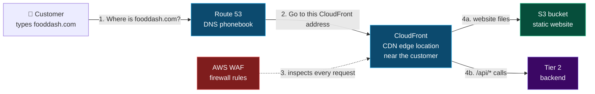

# 01 · Tier 1: Presentation (Frontend and Edge)

> **In FoodDash terms:** everything the customer touches first. Typing `fooddash.com`, seeing the restaurant list, loading food photos fast, and being protected from attackers before a request ever reaches our kitchen (the backend).

---

## The request journey through Tier 1

## Lessons in this module

| # | Lesson | One-line meaning |
|---|---|---|
| 1.1 | **S3 static website hosting** | Put the FoodDash website files (HTML, CSS, JS) in a cloud folder |
| 1.2 | **CloudFront** (Content Delivery Network) | Keep copies near customers in 400+ edge locations so pages load fast |
| 1.3 | **Route 53** (DNS, Domain Name System) | The internet's phonebook; named after DNS port 53. Covers records and *Alias* records |
| 1.4 | **ACM** (AWS Certificate Manager) | Free HTTPS padlock certificates |
| 1.5 | **AWS WAF** (Web Application Firewall) | A security guard that blocks bad requests before they reach us |
| 1.6 | **Public subnets and edge locations** | Which parts of the system are allowed to face the internet |

🎬 Animation: *coming soon*
