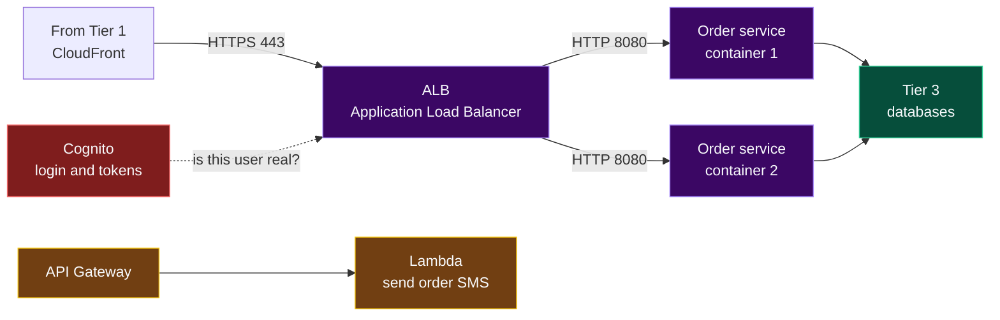

# 02 · Tier 2: Application (Backend and Business Logic)

> **In FoodDash terms:** the kitchen. When a customer taps "Place Order", this tier checks who they are, calculates the bill, talks to the restaurant, and saves the order.

---

## How an order reaches the kitchen

## Lessons in this module

| # | Lesson | One-line meaning |
|---|---|---|
| 2.1 | **EC2** (Elastic Compute Cloud) | Rent a virtual computer by the second |
| 2.2 | **ALB** (Application Load Balancer) | Spread incoming orders across many servers, skip broken ones |
| 2.3 | **Auto Scaling Groups** | Add servers at lunch rush, remove them at 3 AM |
| 2.4 | **ECS** (Elastic Container Service) + **Fargate** | Run the Java app as Docker containers without managing servers |
| 2.5 | **Lambda + API Gateway** | Run small functions only when something happens |
| 2.6 | **Cognito** | Sign-up, login, and secure tokens for customers |
| 2.7 | **Private subnets and Security Groups** | Keep the kitchen hidden from the internet, allow only the ALB in |

🎬 Animation: *coming soon*
