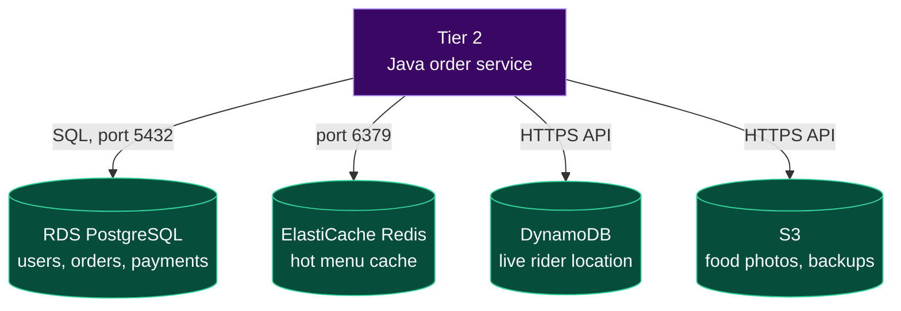

# 03 · Tier 3: Data and Storage

> **In FoodDash terms:** the memory of the business. Who our customers are, every menu, every order and payment, live rider locations, and every food photo.

---

## Picking the right storage for each job

## Lessons in this module

| # | Lesson | One-line meaning |
|---|---|---|
| 3.1 | **S3** (Simple Storage Service) deep dive | Unlimited file storage: buckets, objects, storage classes, lifecycle rules |
| 3.2 | **RDS** (Relational Database Service) | Managed SQL databases (PostgreSQL, MySQL) with backups and Multi-AZ |
| 3.3 | **DynamoDB** | NoSQL key-value database that stays fast at any scale |
| 3.4 | **ElastiCache** (Redis) | In-memory cache so popular menus load in under a millisecond |
| 3.5 | **Isolated subnets and encryption** | Databases with no internet route at all, data encrypted with KMS |

🎬 Animation: *coming soon*
