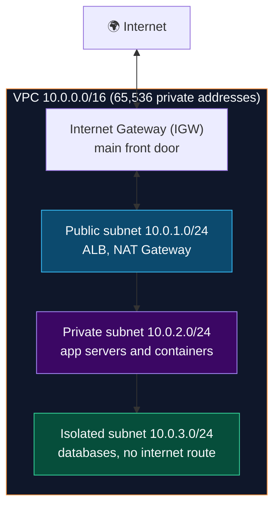

# 04 · Networking (VPC) and Security

> **In FoodDash terms:** the building and its locks. A private gated building (VPC) with a public lobby (public subnet), a staff-only kitchen (private subnet), and a locked vault (isolated subnet).

---

## The FoodDash network

## Lessons in this module

| # | Lesson | One-line meaning |
|---|---|---|
| 4.1 | **IAM** (Identity and Access Management) | Users, roles, policies: who is allowed to do what |
| 4.2 | **Regions and Availability Zones** | Where AWS data centers physically are, and why we use 2 or more |
| 4.3 | **VPC and CIDR blocks** | Your private network, and what `10.0.0.0/16` actually means |
| 4.4 | **Subnets and Route Tables** | Public vs private vs isolated, and the `0.0.0.0/0` rule |
| 4.5 | **Internet Gateway and NAT Gateway** | The front door, and the one-way exit for private servers |
| 4.6 | **Security Groups vs NACLs** | Per-server firewall vs per-subnet firewall |
| 4.7 | **Secrets Manager and KMS** | Storing passwords and encryption keys safely |

🎬 Animation: *coming soon*
