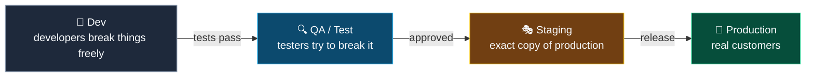

# 05 · Deployment Tiers: Dev, QA, Staging, Prod

> **In FoodDash terms:** how a new feature (say, "Schedule an order for later") travels from your laptop to millions of hungry customers without breaking anything.

---

## The same app, four separate copies

## Lessons in this module

| # | Lesson | One-line meaning |
|---|---|---|
| 5.1 | **Why 4 environments** | What each one is for, and what goes wrong if you skip one |
| 5.2 | **AWS Organizations and multi-account setup** | One AWS account per environment, so Dev can never touch Prod |
| 5.3 | **IAM boundaries between environments** | Who can deploy where |
| 5.4 | **CI/CD pipelines** | GitHub Actions or CodePipeline moving code through the stages automatically |
| 5.5 | **Blue/Green deployments** | Run old and new side by side, switch traffic instantly, switch back if broken |
| 5.6 | **Canary deployments** | Send 5% of customers to the new version first, then grow |

🎬 Animation: *coming soon*
