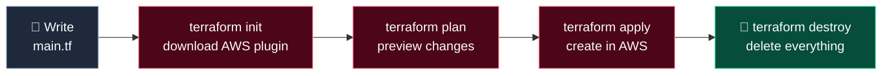

# 06 · Infrastructure as Code (Terraform)

> **In FoodDash terms:** instead of clicking 300 buttons in the AWS console (and forgetting which ones), we write the whole FoodDash setup as code. One command builds it. One command (`terraform destroy`) deletes it. That is also our best weapon for keeping the bill at $0.00.

---

## The Terraform loop

## Lessons in this module

| # | Lesson | One-line meaning |
|---|---|---|
| 6.1 | **Why IaC** | Repeatable, reviewable, deletable infrastructure |
| 6.2 | **Terraform basics** | Providers, resources, variables, outputs |
| 6.3 | **State files** | How Terraform remembers what it built (and why `.tfstate` is never committed) |
| 6.4 | **Remote state on S3** | Sharing state safely across a team, with locking |
| 6.5 | **Modules** | Reusable building blocks: one VPC module used by Dev, QA, Staging, Prod |
| 6.6 | **Full FoodDash in Terraform** | The complete 3-tier app, built and destroyed from code |

🎬 Animation: *coming soon*
