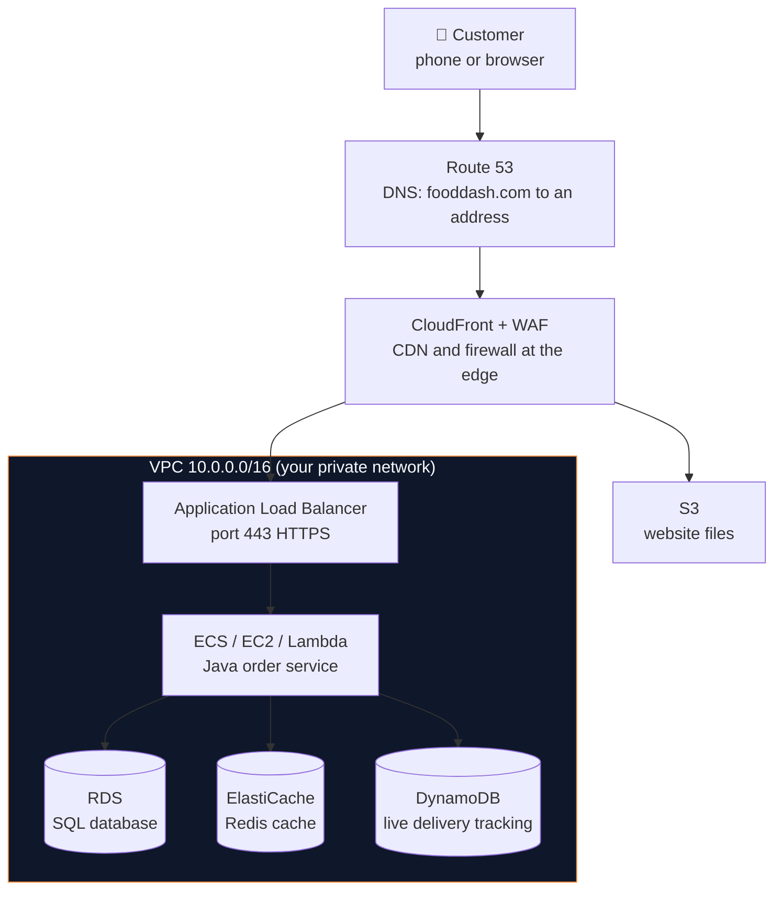

<div align="center">

# ☁️ AWS Visual Architecture Mastery

### Learn AWS from absolute zero to production level, explained like a friend over coffee, with interactive animated diagrams for every concept.

**No dry docs. No paid course. No unexplained jargon.**


</div>

---

## 🍔 The idea: learn AWS by building one real app

Most AWS tutorials throw 200 services at you with no story. Here, every service gets a **real job** inside one app you already understand:

> **FoodDash**: a food delivery platform like Swiggy or Zomato.
> Customers browse restaurants, place orders, pay, and track their delivery live.

| When you hear... | Think of its job in FoodDash |
|---|---|
| **S3** (Simple Storage Service) | The giant cupboard that stores food photos and the website files |
| **CloudFront** (CDN, Content Delivery Network) | Copies of the menu kept in every city, so it loads fast everywhere |
| **ALB** (Application Load Balancer) | The receptionist who sends each order to a free kitchen |
| **EC2 / ECS / Lambda** | The kitchens where the order logic actually runs |
| **RDS** (Relational Database Service) | The order register: who ordered what, and did they pay |
| **VPC** (Virtual Private Cloud) | The private, gated building where all of this lives |

---

## 🗺️ The learning path

```mermaid
flowchart LR
    P0["Phase 0<br/>Why AWS exists<br/>(5 revolutions)"] --> T1["Tier 1<br/>Frontend and Edge"]
    T1 --> T2["Tier 2<br/>Backend and Logic"]
    T2 --> T3["Tier 3<br/>Data and Storage"]
    T3 --> NET["Networking<br/>VPC and Security"]
    NET --> DEP["Phase 2<br/>Dev, QA, Staging, Prod"]
    DEP --> IAC["Infrastructure<br/>as Code"]

    style P0 fill:#1e293b,stroke:#94a3b8,color:#f8fafc
    style T1 fill:#0c4a6e,stroke:#38bdf8,color:#f8fafc
    style T2 fill:#3b0764,stroke:#a78bfa,color:#f8fafc
    style T3 fill:#064e3b,stroke:#34d399,color:#f8fafc
    style NET fill:#7c2d12,stroke:#fb923c,color:#f8fafc
    style DEP fill:#713f12,stroke:#facc15,color:#f8fafc
    style IAC fill:#4c0519,stroke:#fb7185,color:#f8fafc
```



## 🏗️ What FoodDash looks like when finished



---

## 📂 Repository structure

| Folder | What you will learn | Status |
|---|---|---|
| [`00-history-and-cloud-evolution`](./00-history-and-cloud-evolution) | Bare-metal servers, VMs, cloud, containers, serverless: why AWS exists at all | 🟢 Lessons 0.1 to 0.2 live |
| [`01-tier-1-presentation-frontend`](./01-tier-1-presentation-frontend) | Route 53, CloudFront, S3 static hosting, WAF, edge locations | ⚪ Planned |
| [`02-tier-2-application-backend`](./02-tier-2-application-backend) | ALB, EC2, ECS, Lambda, API Gateway, Cognito | ⚪ Planned |
| [`03-tier-3-data-and-storage`](./03-tier-3-data-and-storage) | RDS, DynamoDB, ElastiCache, S3 for media and backups | ⚪ Planned |
| [`04-networking-vpc-and-security`](./04-networking-vpc-and-security) | VPC, subnets, CIDR, route tables, security groups, IAM | ⚪ Planned |
| [`05-deployment-tiers-dev-qa-staging-prod`](./05-deployment-tiers-dev-qa-staging-prod) | Dev, QA, Staging, Prod environments, Blue/Green and Canary releases | ⚪ Planned |
| [`06-infrastructure-as-code`](./06-infrastructure-as-code) | Terraform: build all of the above from code | ⚪ Planned |
| [`visual-app`](./visual-app) | **The interactive app** (React + TypeScript + Tailwind + Framer Motion): animated timeline, step-by-step walkthroughs, click-anything detail inspector, Lesson 0.1, light/dark/system theme | 🟢 [Live app](https://jyotipr45.github.io/aws-visual-architecture-mastery/visual-app/) |
| [`visual-animations`](./visual-animations) | First-version single-file HTML animations, kept for reference | ⚪ Legacy |

---

## 📖 How every lesson works

1. **One concept at a time.** Never more than one new idea per lesson.
2. **Zero jargon left unexplained.** Every acronym gets: what it stands for, its nickname, why it exists, and what it connects to.
3. **See it.** An interactive animation in the [visual app](https://jyotipr45.github.io/aws-visual-architecture-mastery/visual-app/) (Play, Pause, Step, Speed, Zoom, click anything to inspect it) plus a Mermaid diagram right here on GitHub.
4. **Do it.** A hands-on lab with real commands.
5. **Test it.** A "What happens if...?" scenario to check you really understood.
6. **Clean it up.** 🧹 A mandatory cleanup step so your AWS bill stays at **$0.00**.

---

## 💰 Cost safety rules (read before any lab)

> These rules exist because a forgotten resource is the number one way beginners get a surprise AWS bill.

1. ✅ **Set a billing alarm first.** Create a Zero Spend budget in AWS Budgets so you get an email the moment anything costs money.
2. ✅ **Never use the root account for labs.** Use an IAM user or IAM Identity Center user with only the permissions you need.
3. ✅ **Every lab ends with a cleanup step.** `terraform destroy` or the listed `aws ... delete` commands. No exceptions.
4. ✅ **Check before you sleep.** Open the AWS Billing console and Cost Explorer after each lab.
5. ❌ **Never commit secrets.** Access keys, `.tfstate` files and `.env` files are blocked by this repo's `.gitignore`.

---

## 🛠️ Tools used

| Tool | Why |
|---|---|
| **AWS CLI v2** | Talk to AWS from your terminal |
| **Terraform** | Describe infrastructure as code, create it, destroy it with one command |
| **Java 17+ / Spring Boot** | The FoodDash backend code |
| **Git + GitHub CLI (`gh`)** | Version control and publishing |
| **Node.js 20+ / React / TypeScript / Tailwind CSS / Framer Motion** | The interactive visual app in `visual-app/` |
| **Any modern browser** | Use the live app, or open the legacy animations in `visual-animations/` |

---

## ▶️ How to use this repo

```bash
git clone https://github.com/Jyotipr45/aws-visual-architecture-mastery.git
cd aws-visual-architecture-mastery
```

Then start with [`00-history-and-cloud-evolution`](./00-history-and-cloud-evolution) and open the
**[live interactive app](https://jyotipr45.github.io/aws-visual-architecture-mastery/visual-app/)**.

To run the app on your own computer:

```bash
cd visual-app
npm install
npm run dev
```

---

## 👤 Author

**Jyoti Prakash Parida**, backend engineer (Java, Spring Boot) moving into DevOps and cloud.
Building this repo in public while learning AWS end to end.

⭐ If this repo saves you from reading 40 pages of docs, give it a star.

## 📄 License

[MIT](./LICENSE): free to learn from, share, and build on.
